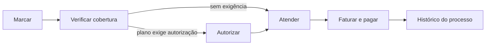
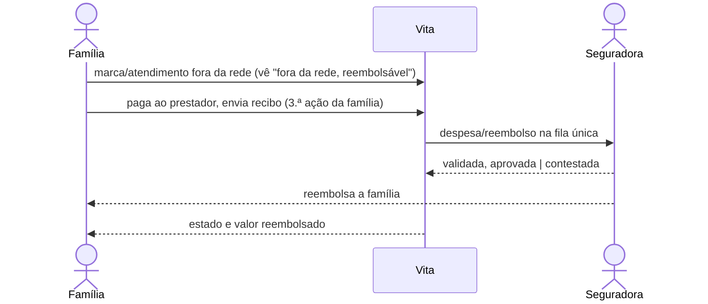

# Vita Family — Fluxos de processo entre as apps (marcar, cobrir, autorizar, atender, faturar)

> Estado: **v0.1 PROPOSTO (2026-11-14)** — fluxo aprovado como direção pelo proprietário em conversa; **nada aqui está contratado, decidido em ADR nem implementado**. Depende de ADR-029/030/031 (todos "Proposto"), de `business-model.md` (conflitos C1–C10 por resolver) e do plano de marcos B/C (`plan.md` §4 "Propostos pós-M15"). **A cobertura típica de seguro de saúde descrita (quem exige autorização, o que é rotina, tetos) é SUPOSIÇÃO a validar com seguradoras: a cobertura real vem sempre do plano configurado pela seguradora.** Não é parecer jurídico nem regulatório.
> **Decisões do proprietário de 2026-11-14 (Q-U1, Q-C1, Q-P1, Q-S1): REGISTADAS como DECIDIDAS em §10** (com as alternativas rejeitadas). As alterações que delas decorrem a regras/casos de uso aprovados (BR-SEG-10, UC-SEG-10, BR-SEG-06/08) são **propostas pendentes de aprovação** (§11a); o modelo `Process` é **Proposto** (§13). Nada contratado nem implementado.
> Regras de leitura: onde este documento contradiz um documento aprovado, vale o aprovado e a divergência está listada em §11 (não decidida aqui). Máquinas de estados em `04-domain/state-machines.md` §"Propostas — fluxo de processo". Regras existentes citadas: BR-SEG-* (`business-rules.md` §15), casos de uso UC-SEG-05..13 (`03-use-cases/insurer-operations.md`).

## 1. Princípios (simplicidade)
1. **Espinha única:** Marcar → Verificar cobertura → Autorizar (só se o plano exigir) → Atender → Faturar e pagar. Todos os percursos são variantes da mesma espinha.
2. **Processo:** cada ato (consulta, exame, cirurgia, levantamento de medicamento...) é um **processo** com identificador único (`processId`), estado e histórico, visível a família, prestador e seguradora **à sua medida** (§5). **DECIDIDO 2026-11-14 (Q-P1):** o processo é uma **entidade nova** (`Process`) que liga marcação, autorização, atendimento e despesa; vista única, com estado simples para a família (modelo mínimo Proposto em §13).
3. **A família faz 3 coisas:** marcar, ver o estado, enviar o recibo (quando fora da rede).
4. **O prestador tem 1 fluxo:** confirmar elegibilidade (QR, 1 toque) → pedir autorização (mesmo ecrã, se exigida) → atender e faturar (mesmo ecrã).
5. **"Exige autorização" é configuração do plano** (por serviço e teto: `requiresAuthorization`, teto de auto-aprovação, tolerância; BR-SEG-02/03/13), nunca código nem lista fixa no Vita.
6. **Caixa única de notificações** por pessoa/conta (reutiliza `Alert`/`Notification`; eventos em §6).
7. **Prestador sem seguradora** só tem marcação e atendimento (ADR-030 §7); os passos de cobertura/autorização/despesa só existem com convenção.
8. **Diagnóstico não viaja para a seguradora por defeito** (BR-SEG-23 "Q5"; conflito **C2** por resolver, §9).
9. **O Vita não é TPA** (ADR-029): a seguradora decide e paga; o Vita encaminha, calcula e mostra. **Copagamento pago no balcão do prestador; o Vita só calcula e mostra (antes e depois do ato), não processa pagamento (DECIDIDO 2026-11-14, Q-C1, §10).**

## 2. Espinha única


## 3. Os quatro percursos (+ farmácia)
Tabela de classificação **típica (SUPOSIÇÃO a validar com seguradoras)**; na prática o percurso resulta da combinação serviço × plano × prestador (na rede ou fora).

| Percurso | Exemplos típicos | Autorização | Elegibilidade | Quem paga o quê |
|---|---|---|---|---|
| **Rotina** | consulta, análises simples, vacinas | não | imediata (QR) | copagamento no balcão; seguradora paga o resto ao prestador |
| **Com autorização** | TAC/RM, cirurgia, internamento programado, dentário, fisioterapia | sim (se o plano o exigir) | QR + pedido | copagamento **depois de aprovada**; seguradora paga o aprovado ao prestador |
| **Urgência** | urgência, internamento não programado | **a posteriori**: atende-se primeiro, notifica-se a seguradora **até 48 h**, regulariza-se depois; prazo falhado ⇒ revisão manual pela seguradora, não recusa automática (DECIDIDO 2026-11-14, Q-U1, §10) | QR (se possível) | idem, após regularização |
| **Fora da rede** | prestador sem convenção | não aplicável | "fora da rede, reembolsável" | família paga tudo, pede reembolso com recibo; seguradora reembolsa a família |
| **Farmácia** | medicamentos | não (rotina) se receita Vita + farmácia na rede | QR no balcão | copagamento no balcão; fora da rede → reembolso |

### 3.1 Rotina
```mermaid
sequenceDiagram
  actor F as Família
  participant V as Vita
  actor P as Prestador
  participant S as Seguradora
  F->>V: marca (vê "coberto, copagamento X" ou "fora da rede, reembolsável")
  V-->>P: marcação (processo criado)
  P->>V: confirma elegibilidade (QR, 1 toque)
  V->>S: valida plano/estado (BR-SEG-01/18)
  V-->>P: elegível + copagamento (verificação, não garantia de pagamento)
  P->>V: atende e fatura (mesmo ecrã)
  V->>S: despesa (calculada BR-SEG-06/08)
  S->>S: auto-aprova se cumpre regras; analista só vê exceções
  S-->>P: paga ao prestador
  V-->>F: estado, saldo, laudo/receita no histórico
```
### 3.2 Com autorização
```mermaid
sequenceDiagram
  actor F as Família
  participant V as Vita
  actor P as Prestador
  actor A as Seguradora (fila única)
  F->>V: marca
  P->>V: QR, elegibilidade: "exige autorização"
  P->>V: pede autorização (mesmo ecrã; serviço, justificação, anexos, valor)
  V->>A: auto-aprova se cumpre BR-SEG-03, senão entra na fila
  A-->>V: aprovada | aprovada em parte | recusada | falta informação
  V-->>P: decisão + código (BR-SEG-05)
  V-->>F: estado e copagamento final
  P->>V: atende e fatura (autorização passa a "usada")
  A-->>P: paga ao prestador
```
### 3.3 Urgência
```mermaid
sequenceDiagram
  actor F as Família
  actor P as Prestador
  participant V as Vita
  actor A as Seguradora
  P->>V: abre processo de urgência (atende primeiro; QR se possível)
  P->>V: notifica a seguradora (prazo 48 h)
  V->>A: autorização "a posteriori" (fila única, marcada urgência)
  A-->>V: regulariza: aprovada | em parte | recusada | falta informação (se o prazo de 48 h falhou: revisão manual, nunca recusa automática)
  P->>V: fatura
  A-->>P: paga o aprovado
  V-->>F: estado e copagamento
```
### 3.4 Fora da rede (reembolso)

### 3.5 Farmácia
Receita Vita + farmácia na rede ⇒ rotina (QR no balcão, copagamento, despesa). Fora da rede ⇒ §3.4. **Dependências por clarificar (§11 D8):** não existe hoje uma "receita Vita" emitida por prestador com valor operacional para a farmácia.

## 4. Passos por ator (percurso com autorização; os outros omitem passos assinalados)
| # | Passo | Família | Prestador | Seguradora | Empresa (Fase 2) | Processo |
|---|---|---|---|---|---|---|
| 1 | Marcar | marca; vê dentro/fora da rede e "coberto, copagamento X" | recebe marcação | — (não vê marcação por defeito; §11 D9) | — | nasce `processId`; Marcação `marcada` |
| 2 | Confirmar presença | "Vou"/"Não posso" (BR-CLN-26) | confirmação ativa (BR-CLN-25) | — | — | Marcação `confirmada` |
| 3 | Verificar cobertura | vê o resultado no histórico | **QR, 1 toque** (BR-SEG-18) | responde com resposta mínima | — | verificação auditada |
| 4 | Autorizar (se exigido) | vê estado | pede (mesmo ecrã) | auto-aprova ou analista decide | — | Autorização `pedida` → ... |
| 5 | Atender | recebe laudo/receita no histórico (ADR-027/028) | atende (mesmo ecrã que a faturação) | — | — | Marcação `atendida`; Autorização `usada` |
| 6 | Faturar | vê despesa e valor a pagar | submete despesa (UC-SEG-11) | fila única; auto-aprova ou analista | — | Despesa `submetida` → ... |
| 7 | Pagar | paga copagamento no balcão (Vita só mostra) | recebe copagamento; recebe da seguradora o restante | paga ao prestador (fora do Vita, ADR-029) | — | Despesa `paga` |
| 8 | Reembolso (fora da rede) | envia recibo | — | valida/aprova e reembolsa a família | — | Despesa/reembolso `submetida` → `paga` |
| 9 | Indicadores | — | — | vê tudo o seu | **só agregados anónimos (k mínimo), adesão** | fora do fluxo individual (ADR-031) |

## 5. Quem vê o quê em cada estado
Legenda: **V** vê · **E** age · **M** só o mínimo · **—** não vê. "Diagnóstico" nunca viaja por defeito (C2).

| Estado | Família | Prestador | Seguradora |
|---|---|---|---|
| Marcação `marcada`/`confirmada` | V/E | V/E | — (D9) |
| Autorização `pedida` / `em análise` | V (estado) | V/E (pede, responde) | V/E (analista; fila única) |
| Autorização `falta informação` | V (estado e motivo) | V/E (responde) | V |
| Autorização `aprovada` / `aprovada em parte` | V (valor, copagamento) | V (código, valor, validade) | V/E |
| Autorização `recusada` | V (motivo geral) | V (motivo; recurso) | V/E |
| Autorização `usada` / `expirada` | V | V | V |
| Despesa `submetida` / `validada` | V (valor, copagamento) | V/E | V/E |
| Despesa `aprovada` / `paga` | V | V | V/E |
| Despesa `contestada` | V (motivo) | V/E (responde) | V/E |
| Reembolso (fora da rede) | V/E (recibo, estado) | — | V/E |
| Laudo / receita | V (histórico) | V (os seus; consentimento) | **—** (só o mínimo autorizado, C2) |
| Convenções e preços | — | só a sua | V/E |

## 6. Notificações por transição (caixa única; eventos propostos, sem texto clínico)
Canal e retry como `Alert/Notification` (ST6). Os alertas à família não contêm diagnóstico (BR-ALR existentes).

| Transição | Destinatários | Evento proposto |
|---|---|---|
| Marcação criada / confirmada / cancelada / falta | família, prestador | `PROCESS_APPOINTMENT_*` (reutiliza lembretes/`APPOINTMENT_*` existentes) |
| Autorização pedida | seguradora (fila) | `AUTH_REQUESTED` |
| Aprovada / aprovada em parte / recusada | prestador, família | `AUTH_APPROVED` / `AUTH_PARTIAL` / `AUTH_DENIED` |
| Falta informação | prestador | `AUTH_INFO_REQUESTED` |
| A expirar (D-7 e D-1, a decidir) / expirada | prestador, família | `AUTH_EXPIRING` / `AUTH_EXPIRED` |
| Usada | família | `AUTH_USED` |
| Urgência por notificar (aviso intermédio a T+24 h, a decidir) / prazo (T+48 h, DECIDIDO) | prestador; no incumprimento, seguradora (fila de revisão manual) | `URGENT_NOTIFY_DUE` / `URGENT_NOTIFY_OVERDUE` |
| Despesa submetida | seguradora | `EXPENSE_SUBMITTED` |
| Validada / aprovada / paga | prestador, família | `EXPENSE_VALIDATED` / `EXPENSE_APPROVED` / `EXPENSE_PAID` |
| Contestada | prestador (ou família) | `EXPENSE_DISPUTED` |
| Reembolso aprovado / pago | família | `REIMBURSEMENT_APPROVED` / `REIMBURSEMENT_PAID` |
| SLA da análise (48 h, DECIDIDO) ultrapassado | `SUPERVISOR` da seguradora (escalada; DECIDIDO Q-S1b) e prestador (aviso) | `SLA_BREACH` (+ `AUTH_ESCALATED` ao prestador, proposto) |

## 7. Regras de negócio candidatas (IDs PROVISÓRIOS; não substituem BR-SEG-*)
Reutilizam BR-SEG-01..16/21/22 onde já cobrem; as abaixo são **novas ou estendidas** e só entram em `business-rules.md` após aprovação.

| ID | Regra candidata | Relação com o existente |
|---|---|---|
| BR-AUT-01 | Cada ato tem um `processId` único (entidade `Process`, DECIDIDO 2026-11-14, Q-P1); marcação, autorização, atendimento, despesa e reembolso referenciam-no. | **Novo** (não há entidade "processo" hoje; D1; modelo Proposto em §13). |
| BR-AUT-02 | "Exige autorização" é configuração do plano por serviço (e teto); o Vita não guarda lista própria. | = BR-SEG-02/03 (confirma). |
| BR-AUT-03 | Auto-aprovação só quando as regras simples do plano forem todas verdadeiras (serviço coberto, beneficiário elegível, dentro do teto, sem carência; DECIDIDO Q-A1); o resto vai para analista; reversível. | = BR-SEG-03/16. |
| BR-AUT-04 | **Aprovada em parte:** a decisão fixa `authorizedAmount` < pedido (ou serviços parciais); o resto é recusado com motivo. | **Novo estado** (hoje `APPROVED` com `authorizedAmount`, UC-SEG-07). |
| BR-AUT-05 | **Urgência:** é permitido atender sem autorização prévia; a notificação à seguradora é obrigatória **em 48 h** (DECIDIDO 2026-11-14, Q-U1); a autorização é regularizada **a posteriori**; se o prazo falhar, **revisão manual pela seguradora (nunca recusa automática)**. | **Novo; conflita com UC-SEG-10/BR-SEG-10** (D3; alteração proposta em §11a). |
| BR-AUT-06 | Prazo de análise (SLA) de **48 h** (DECIDIDO 2026-11-14, Q-S1); ao ultrapassar, o pedido **escala para o gestor** da seguradora (`SLA_BREACH`) e o **prestador é avisado**; **nunca aprova por silêncio**. **Q-S1b (DECIDIDO):** 48 h é o valor por omissão, configurável por seguradora e por serviço dentro de mínimo/máximo do Vita; o «gestor» é o papel `SUPERVISOR` (≠ analista). | Novo. |
| BR-AUT-07 | Autorização expira após `validUntil` e liberta reserva; uma autorização usada não se reutiliza. | = BR-SEG-05/07 (estados `USED`/`EXPIRED`). |
| BR-AUT-08 | **Recurso:** decisão `recusada` pode ser contestada pelo prestador **várias vezes, sem limite fixo** (DECIDIDO Q-S2), cada vez com justificação/anexos; cada recurso gera novo pedido ligado ao anterior (não reabre o estado final). Salvaguardas contra arrastar o processo: PROPOSTAS em §11a (pendentes). | Novo (hoje `REJECTED` é final). |
| BR-AUT-09 | Duplicado de pedido: mesmo beneficiário + prestador + serviço + janela de datas ⇒ sinal para o prestador e idempotência (`Idempotency-Key`). | Estende BR-SEG-11 às autorizações. |
| BR-DSP-01 | A despesa só existe com atendimento; com autorização válida quando exigida (exceto urgência, BR-AUT-05). | = BR-SEG-10. |
| BR-DSP-02 | Cálculo `insurerShare`/`patientShare` pelo Vita; **copagamento pago no balcão; o Vita não processa pagamento.** O cálculo é feito **antes** (estimativa, na marcação/elegibilidade) **e depois** do ato (valor final na despesa). | DECIDIDO 2026-11-14 (Q-C1, ADR-029); = BR-SEG-06/08 + pré-cálculo (D11). |
| BR-DSP-03 | Validação automática (cumpre regras do plano, sem flags) → `validada`; exceções (duplicado, valor > autorizado+tolerância, urgência por regularizar) vão ao analista. | = BR-SEG-11/13. |
| BR-DSP-04 | **Contestada:** prestador ou família podem contestar uma decisão da seguradora uma vez, com motivo. | Novo (hoje `REJECTED`/`RETURNED`; D5). |
| BR-DSP-05 | Reembolso fora da rede: a família envia recibo (ou documento) e a seguradora reembolsa a **família**; o prestador não participa. | Estende ADR-021/BR-INS-03..05 (D4). |
| BR-DSP-06 | Duplicado: um atendimento `DIRECT_BILLED` não admite reembolso (conflito). | = BR-SEG-21. |
| BR-DSP-07 | O pagamento é feito pela seguradora (ao prestador ou à família); a **seguradora regista `paga`**; no pagamento ao prestador, o **prestador confirma a receção**; o Vita só regista e não detém fundos (DECIDIDO Q-F1). | ADR-029; **altera BR-INS-05** (proposta, §11a). |
| BR-AUT-10 | **Falta (no-show):** a autorização mantém-se válida até `validUntil`; a falta fica registada; reagendar dentro do prazo não exige novo pedido (DECIDIDO Q-S3). | Novo. |
| BR-AUT-11 | **Saldo:** a família vê saldo e tetos/consumo; o prestador vê só sim/não e copagamento, sem saldo total (DECIDIDO Q-T1). | Estende BR-SEG-18 (resposta mínima). |

## 8. Casos de erro e exceção
| Caso | Tratamento proposto |
|---|---|
| **Prazo de análise (SLA)** | `pedida`/`em análise` acima de 48 h ⇒ `SLA_BREACH`, escala para o `SUPERVISOR`, aviso ao prestador e destaque na fila; **sem aprovação tácita nunca** (DECIDIDO, Q-S1/Q-S1b: 48 h por omissão, configurável; escala para o Supervisor; prestador avisado). |
| **Expiração** | Autorização `aprovada` sem uso até `validUntil` ⇒ `expirada` (job diário, como BR-SEG-28), reserva libertada; novo pedido necessário. |
| **Falta de informação** | prestador responde (UC-SEG-08); sem resposta em **7 dias** ⇒ pedido caduca (DECIDIDO Q-S1b); pode reabrir com novo pedido. |
| **Recusa e recurso** | `recusada` é final; recurso = novo pedido ligado (BR-AUT-08); **vários recursos, sem limite fixo (DECIDIDO Q-S2)**; salvaguardas propostas em §11a. Despesa recusada ⇒ `contestada` (BR-DSP-04). |
| **Cancelamento** | Marcação cancelada antes do ato ⇒ autorização ligada cancelada e reserva libertada; analista pode cancelar autorização `aprovada` com motivo (BR-SEG-16); prestador pode cancelar a sua antes de `usada`. |
| **Falta (no-show)** | Marcação `falta` ⇒ a autorização não é usada e continua válida até expirar e a falta fica registada; reagendar no prazo sem novo pedido (DECIDIDO, Q-S3). |
| **Duplicados** | Idempotência em pedidos e despesas; despesa duplicada nunca rejeitada automaticamente (BR-SEG-11). |
| **Valor faturado > autorizado** | `em análise` obrigatória (BR-SEG-13). |
| **Seguradora suspensa / prestador suspenso / convenção terminada a meio** | Novos pedidos `NOT_FOUND` (BR-SEG-29); processos em curso mantêm-se visíveis (comportamento de BR-INS-10); regularização manual. |
| **Elegibilidade falsa positiva** | A resposta é "verificação de cobertura, não garantia de pagamento" (`insurer-phase-a.md` §7) até a autorização existir. |
| **Urgência sem notificação no prazo** | Passadas 48 h: `URGENT_NOTIFY_OVERDUE` e **revisão manual pela seguradora; não há recusa automática** (DECIDIDO, Q-U1). |
| **Sem saldo / teto esgotado** | Aprovação só até ao saldo ou recusa (UC-SEG-07); família vê saldo e tetos; prestador vê só sim/não e copagamento (DECIDIDO Q-T1). |

## 9. Dados mínimos por pedido (sem diagnóstico por defeito)
| Pedido | Campos mínimos |
|---|---|
| **Autorização** | `processId`, beneficiário (via cartão/QR), prestador, serviço (`serviceCode` da seguradora, BR-SEG-22), valor estimado, data prevista, urgência (sim/não), justificação **administrativa** curta, anexos opcionais (sem laudo por defeito). Resposta: estado, `authorizedAmount`, `validUntil`, código, motivo. |
| **Despesa** | `processId`, atendimento (data, prestador, médico em texto), linhas (serviço, quantidade, valor), autorização/código (se exigida), anexos (fatura). **Sem diagnóstico** (BR-SEG-23). |
| **Reembolso** | `processId`, beneficiário, prestador (texto/NIF), data, serviço, valor pago, recibo (`receiptId`/`documentId`; BR-CLN-36). Sem dados clínicos. |
| **Urgência** | Hora de admissão, tipo (urgência/internamento), prestador; resto igual à autorização; notificação. |
Se a seguradora precisar de informação clínica para decidir, só pela lista fechada do **mínimo do ato autorizado** com consentimento (**C2**, por decidir; hoje BR-INS-08/BR-SEG-18/23 dizem "não").

## 10. Questões (decisões do proprietário)
### 10.1 DECIDIDAS em 2026-11-14 (o histórico das alternativas mantém-se)
| ID | Decisão (2026-11-14) | Alternativas / recomendações provisórias NÃO adotadas ou superadas |
|---|---|---|
| **Q-U1** Urgência | **DECIDIDO:** atende-se primeiro; prazo de aviso à seguradora **48 h**; se falhar o prazo, **revisão manual pela seguradora (não recusa automática)**. | Antes: prazo 24–48 h "a fixar por convenção". Rejeitado: prazo de 24 h; recusa automática por atraso; exigir autorização prévia também na urgência (regra atual UC-SEG-10/BR-SEG-10, a alterar, §11a). |
| **Q-C1** Copagamento | **DECIDIDO:** pago no **balcão do prestador**; o Vita só **calcula e mostra (antes e depois)**, **não processa pagamentos** (continua software, não TPA; ADR-029). | Rejeitado: pagamento do copagamento dentro do Vita (TPA/TPA-like, risco regulatório ARSEG, C8). |
| **Q-P1** Processo | **DECIDIDO:** **entidade nova** com identificador único que liga marcação, autorização, atendimento e despesa; vista única; estado simples para a família. Modelo mínimo em §13 (**Proposto**). | Antes: "novo vs derivado do atendimento" e granularidade. Rejeitado: `processId` apenas derivado do atendimento (não cobre marcação sem atendimento nem autorização prévia); referências cruzadas sem entidade (sem vista única nem histórico). |
| **Q-S1** Análise | **DECIDIDO:** prazo de análise **48 h**; passado o prazo o pedido **escala para o gestor** e o **prestador é avisado**; **nunca aprova por silêncio**. | Rejeitado: aprovação tácita. Antes: SLA "configurável, valor por omissão/tipo de serviço a decidir". |
| **Q-S1b** Gestor/prazo | **DECIDIDO:** prazo de decisão **48 h por omissão, CONFIGURÁVEL por seguradora e por serviço**, com **mínimo e máximo definidos pelo Vita** (valores por fixar); «gestor» = **novo papel `SUPERVISOR`** (separação de funções: quem analisa ≠ quem supervisiona; entrada **proposta** em `authorization.md` §8, pendente); `falta informação` **caduca em 7 dias** (pode reabrir com novo pedido). | Rejeitado: 48 h fixo; reutilizar `INSURANCE_ADMIN`/`CLAIMS_MANAGER` como gestor (mistura funções; `INSURANCE_ADMIN` só lê); caducidade com N em aberto. |
| **Q-S2** Recurso | **DECIDIDO:** **vários recursos** após recusa, **sem limite fixo**; cada recurso é um novo pedido ligado (a `recusada` não reabre). **Salvaguardas PROPOSTAS** (a decidir pelo proprietário) em §11a. | Rejeitado: um único recurso (recomendação provisória anterior); limite fixo de recursos. |
| **Q-S3** Falta (no-show) | **DECIDIDO:** a autorização **mantém-se válida até expirar**; a falta **fica registada**; **reagendar no prazo sem novo pedido** (dentro de `validUntil`). | Rejeitado: cancelar a autorização por falta; exigir novo pedido ao reagendar. |
| **Q-A1** Auto-aprovação | **DECIDIDO:** regras **simples do plano**: serviço coberto, beneficiário elegível, dentro do teto, sem carência; **tudo o resto vai para analista**. | Rejeitado: critérios por histórico/rede/risco (complexidade; C1). |
| **Q-T1** Saldo/teto | **DECIDIDO:** a **família** vê saldo e tetos/consumo; o **prestador** vê só **sim/não e copagamento**, **sem saldo total**. | Rejeitado: prestador a ver o saldo do plano (dado comercial/pessoal além do necessário). |
| **Q-F1** Quem marca pago | **DECIDIDO:** a **seguradora regista** o pagamento ao prestador; o **prestador confirma a receção**; o Vita **só regista, não paga** (ADR-029). **Reembolso à família:** a seguradora regista. Altera a regra atual BR-INS-05 (titular marca `PAID`) — **mudança proposta, pendente** (§11a, D4/D6). | Rejeitado: titular/família a marcar `PAID` do reembolso (regra atual); importação de extrato como único meio; Vita a processar pagamentos. |

### 10.2 AINDA EM ABERTO (para fechar o contrato do marco B)
| ID | Questão | Recomendação provisória |
|---|---|---|
| Modelo `Process` | Módulo dono (`insurance` vs módulo próprio); prestador sem seguradora tem `Process`?; ligação a registos de clínica sem ids Vita (BR-CLN-24). | Ver §13. |
| C1–C10 | Conflitos de `business-model.md` §7 (ver §12), em particular C2 (mínimo do ato autorizado) para B. | — |
| Jurídico | Enquadramento regulatório (ARSEG, RGPD, papel de software de ligação). | Parecer jurídico. |
| Valores | Mínimo/máximo do prazo de decisão (Q-S1b) e prazo de resposta/recurso (§11a): números por fixar. | A propor com a seguradora piloto. |

## 11. Divergências e conflitos com a documentação (LISTADAS, NÃO decididas)
| # | Divergência | Onde | Observação |
|---|---|---|---|
| D1 | "Processo" com identificador único e histórico **não existe** (há `AuthorizationRequest`, `ExpenseClaim`, `Encounter`, `Appointment` separados). | `schema.md`, `entities.md` | **Direção DECIDIDA 2026-11-14 (Q-P1): entidade nova `Process`.** Modelo mínimo e migração **Propostos** em §13; `schema.md`/`entities.md` por alterar após aprovação. |
| D2 | Estados propostos de Autorização diferem dos existentes: nomes PT vs `SUBMITTED/AUTO_APPROVED/IN_REVIEW/APPROVED/REJECTED/INFO_REQUESTED/USED/EXPIRED/CANCELLED`; **novo `aprovada em parte`**; `CANCELLED` ausente no fluxo do proprietário; `AUTO_APPROVED` fundido em "aprovada". | `state-machines.md` §AuthorizationRequest | Mapeamento em `state-machines.md`; a aprovação define se `AUTO_APPROVED` se mantém como estado ou vira flag. |
| D3 | Urgência "atende primeiro": UC-SEG-10 diz que serviço que exige autorização sem autorização válida ⇒ `VALIDATION_ERROR`; BR-SEG-10 idem. | `insurer-operations.md` UC-SEG-10, BR-SEG-10 | Exige exceção/regularização a posteriori (BR-AUT-05). **Urgência DECIDIDA (Q-U1, 48 h, revisão manual)**; texto exato das alterações a UC-SEG-10/BR-SEG-10 **proposto em §11a, pendente de aprovação**. |
| D4 | Reembolso de fora da rede: já existe `ReimbursementClaim` (ADR-021), com `APPROVED → PAID` marcado **pelo titular**; o fluxo proposto diz que a seguradora paga/reembolsa e a despesa/reembolso é "`paga`". | `state-machines.md` §ReimbursementClaim, BR-INS-05 | **Q-F1 DECIDIDA:** a seguradora regista o pagamento (reembolso à família incluído); divergência com `ReimbursementClaim` (`PAID` pelo titular) e BR-INS-05: alteração proposta em §11a (pendente). Continua por decidir se `ReimbursementClaim` e a Despesa se unificam. |
| D5 | Estados de Despesa: proposto `submetida → validada → aprovada → paga | contestada`; existente `SUBMITTED/IN_REVIEW/APPROVED/REJECTED/RETURNED`, com `PENDING_PAYMENT → PAID` em fase 2; `contestada` e `validada` não existem (`REJECTED` ≈ recusa). | `state-machines.md` §ExpenseClaim | Mapeamento proposto; `RETURNED` mantido. |
| D6 | `PAID` fora do MVP do módulo; quem o marca não está definido (BR-INS-05: titular). | ExpenseClaim, BR-INS-05 | **Q-F1 DECIDIDA** (seguradora regista; prestador confirma receção); alteração a BR-INS-05 proposta em §11a. |
| D7 | "Fila única de autorizações e despesas": existem papéis separados `AUTHORIZATION_ANALYST` e `CLAIMS_MANAGER`. | `authorization.md` §8 | Vista única é UI/consulta, agora apoiada em `Process` (Q-P1); papéis mantêm-se (decisão). Papel «gestor» = novo `SUPERVISOR` (Q-S1b DECIDIDO; proposta em §11a). |
| D8 | Farmácia: "receita Vita" emitida por prestador não existe (`Prescription` é registo da família; `ExamOrder` é só de exame); `provider_type` não tem imagem nem papel de farmácia no portal. | `entities.md`, ADR-030 | Dependência para a farmácia na rede. |
| D9 | Marcação não é, hoje, visível à seguradora; processo exige correlacionar marcação ↔ autorização. | BR-SEG-18, `authorization.md` | Manter fora por defeito; com `Process` (§13) a seguradora vê o processo e a autorização/despesa, **não** a marcação (campos de agenda fora da sua vista). |
| D10 | Marcação: `marcada → confirmada → atendida | cancelada | falta` vs existente `REQUESTED/SCHEDULED/COMPLETED/CANCELLED/NO_SHOW` + `confirmationStatus` independente (`PENDING/CONFIRMED/DECLINED`). | `state-machines.md` §Appointment, BR-CLN-25/26 | Alinhado por mapeamento; "confirmada" **não** passa a estado (BR-CLN-25). |
| D11 | Copagamento: BR-SEG-06 usa `copayPct` e "comparticipação"; "copagamento X" mostrado à família antes do ato exige cálculo prévio, hoje só na despesa. | BR-SEG-06/08 | **Q-C1 DECIDIDA** (pago no balcão; Vita calcula e mostra antes e depois). Pré-cálculo (estimativa) na marcação/elegibilidade: alteração proposta a BR-SEG-06/08 em §11a, pendente de aprovação. |
| D12 | "Prestador sem seguradora só tem marcação e atendimento" vs ADR-026 (recibos, relatórios, laudos já existem sem seguradora). | ADR-026/030 | Interpretar como "sem módulo de cobertura"; confirmar. |
| D13 | Empresa "fora do fluxo individual" coerente com ADR-031; indicadores dependem de C1/C10. | ADR-031 | — |
| D14 | `insurer-phase-a.md` §2 deixa autorizações/despesas "fora da Fase A" (S4/S5); este fluxo é o conteúdo dos marcos B/C. | `insurer-phase-a.md`, `plan.md` §4 | Coerente; sem contrato (`openapi.yaml`) para S4–S5. |

## 11a. Alterações PROPOSTAS a regras aprovadas (PENDENTES de aprovação do proprietário; nada alterado em `business-rules.md`/casos de uso)
Decorrem das decisões de 2026-11-14. Texto atual -> texto proposto.
| Alvo | Texto atual | Texto proposto |
|---|---|---|
| **UC-SEG-10** (`insurer-operations.md` l.43) | Alternativo: "serviço que exige autorização sem autorização válida ⇒ `VALIDATION_ERROR`." | Acrescentar: "**exceto se o atendimento for marcado como urgência** (`isUrgent=true`, internamento/urgência): regista-se o `Encounter` sem autorização, cria-se (ou liga-se) um pedido de autorização `a posteriori` e arranca o relógio de 48 h para notificar a seguradora (BR-AUT-05). Passadas 48 h sem notificação ⇒ `URGENT_NOTIFY_OVERDUE` e **revisão manual** pela seguradora (nunca recusa automática)." |
| **BR-SEG-10** (`business-rules.md` l.310) | "Despesa deve associar beneficiário, apólice vigente na data do atendimento e, se exigida, autorização válida para esse serviço." | Acrescentar: "**Exceção — urgência (DECIDIDO 2026-11-14):** atendimento urgente pode ser despesado sem autorização prévia; fica `IN_REVIEW` com flag `URGENT_UNREGULARIZED` até a autorização `a posteriori` ser decidida (BR-DSP-03). O atraso da notificação não implica recusa." |
| **BR-SEG-06/08** (l.302ss) | Cálculo na despesa. | Acrescentar: "O Vita calcula e mostra o copagamento **estimado antes do ato** (marcação/elegibilidade; "estimativa, não garantia") e o **final depois** (despesa). **O copagamento é pago no balcão do prestador; o Vita não o processa nem recebe fundos** (ADR-029)." |
| **UC-SEG-07 / BR-SEG-03..05** (autorização) | Sem prazo de análise nem efeito do atraso. | Acrescentar: "Prazo de análise 48 h; ultrapassado ⇒ escala para o gestor e aviso ao prestador; **proibida a aprovação tácita**." (depende de Q-S1b para o papel). |
| `authorization.md` §8 | Sem papel de supervisão. | **Proposta (pendente):** novo papel `SUPERVISOR` (Q-S1b), ver `authorization.md` §8.2c. |
| **BR-INS-05** (`business-rules.md` l.261) | "`PAID` é marcado pelo titular/tutor, não pelo portal, nesta versão." | "`PAID` é **registado pela seguradora** (pagamento ao prestador ou reembolso à família); no pagamento ao prestador este **confirma a receção**; o Vita só regista e não paga (DECIDIDO Q-F1)." Impacto: `ReimbursementClaim` (ADR-021) e `state-machines.md`; D4/D6. |
| **BR-SEG-03/16** | Auto-aprovação por regras configuradas (teto, cobertura, carência). | Fixar como mínimo: serviço coberto, beneficiário elegível, dentro do teto, sem carência; o resto vai a analista (Q-A1). |
| **BR-SEG-18** | Resposta mínima ao prestador. | Explicitar: sim/não e copagamento, sem saldo total (Q-T1). |
| **Prazo de decisão** | 48 h fixo (proposta anterior). | 48 h por omissão, configurável por seguradora e serviço entre mínimo e máximo do Vita (valores por fixar); `falta informação` caduca em 7 dias (Q-S1b). |
| **Recurso (BR-AUT-08) — salvaguardas PROPOSTAS, a decidir pelo proprietário** | Vários recursos sem limite fixo (DECIDIDO). | (1) cada recurso exige **informação nova ou motivo** fundamentado; (2) **analista diferente** do que decidiu antes; (3) **prazo de resposta** ao recurso (configurável, p. ex. 48 h) e **prazo máximo para recorrer** após a recusa; (4) **decisão final do `SUPERVISOR`** a partir de N-ésimo recurso (N por fixar) ou a pedido; (5) **estado do Process visível** à família/prestador com contagem de recursos; (6) recurso sem informação nova é recusado liminarmente com motivo; (7) alerta ao Supervisor quando o encadeamento ultrapassa um limiar de tempo total. |

## 13. Modelo mínimo da entidade `Process` (PROPOSTO 2026-11-14; direção DECIDIDA em Q-P1; nada em `schema.md`/`entities.md`/`openapi.yaml`)
**Objetivo:** vista única e id único por ato; estado **simples para a família**; as máquinas de estados existentes (`Appointment`, `AuthorizationRequest`, `Encounter`, `ExpenseClaim`, `ReimbursementClaim`) **mantêm-se** e o `Process` é um agregador (não substitui nem duplica estados).

**Campos propostos (`processes`)**
| Campo | Tipo | Notas |
|---|---|---|
| `id` | uuid PK | = `processId` |
| `kind` | enum `ROUTINE`/`AUTHORIZED`/`URGENT`/`OUT_OF_NETWORK`/`PHARMACY` | percursos §3; derivado, pode mudar de `ROUTINE` para `AUTHORIZED` quando o plano exige |
| `member_id` | FK family_members | beneficiário/paciente (a seguradora só vê via vínculo beneficiário, BR-SEG-14/18) |
| `provider_id` | FK catálogo de prestadores (ADR-030), NULL em fora da rede | prestador |
| `insurer_id`/`policy_id` | FK, NULL se sem seguradora | |
| `family_status` | enum simples: `AGENDADO`/`EM_VALIDACAO`/`A_ATENDER`/`ATENDIDO`/`EM_PAGAMENTO`/`CONCLUIDO`/`CANCELADO` | **estado derivado** das entidades ligadas (não escrito pela UI); mapeamento por tabela a escrever após aprovação |
| `is_urgent` | bool | Q-U1; relógio `urgent_notify_deadline_at` (= admissão + 48 h) |
| `estimated_patient_share` / `final_patient_share` | numeric, NULL | pré-cálculo e final (Q-C1); só informativos |
| `opened_at`, `closed_at` | timestamptz | |

**Relações (todas por FK nullable `process_id` nas entidades ligadas; 1 Process : N)**
- `Appointment` / `ClinicVisit` (1:0..1 por ato), `AuthorizationRequest` (1:N; recurso = novo pedido ligado), `Encounter` (1:0..1), `ExpenseClaim` (1:0..N), `ReimbursementClaim` (1:0..1, fora da rede). `Process` não tem estado clínico nem diagnóstico (BR-SEG-23).
- Registos de clínica sem ids Vita (BR-CLN-24: `clinic_visits`, recibos) **não** recebem FK para `processes`: ligação só por tabela-ponte do lado Vita, para sobreviver ao apagamento (a rever com `vita-architect` antes de migrar).

**Visibilidade:** família vê o `family_status` e o histórico simplificado; prestador vê os seus processos; seguradora vê processos com autorização/despesa do seu tenant, sem marcação (D9). Isolamento por seguradora/clínica como hoje (404 sem enumeração).

**Migração proposta (não escrita; número a atribuir após `0034`):** (1) criar `processes` + enums; (2) adicionar `process_id uuid NULL` a `appointments`, `examinations` (se aplicável), `insurer_authorization_requests`, `insurer_encounters`, `insurer_expense_claims`, `reimbursement_claims`; (3) **backfill**: um `Process` por `Encounter`/`ExpenseClaim`/`ReimbursementClaim` existente (hoje apenas Fase A, sem S4/S5, logo praticamente vazio); marcações antigas ficam sem processo (NULL) e passam a ter `Process` só ao entrarem num percurso com seguradora; (4) NOT NULL só nas tabelas S4/S5 (novas) quando os marcos B/C arrancarem. Reversível (colunas nullable). Exige ADR (proposta: ADR-032 "Entidade Process") e atualização de `schema.md`, `entities.md`, `state-machines.md`, `openapi.yaml`, `modules.md` §3 (módulo dono a decidir: proposta `process` em `insurance` ou módulo próprio).

**Perguntas derivadas (abertas, ver §10.2):** módulo dono do `Process`; se prestador sem seguradora (ADR-030 §7) também tem `Process` (recomendação: sim, só com marcação/atendimento).

## 12. Dependências e conflitos com C1–C10 (`business-model.md` §7)
| Conflito | Efeito neste fluxo |
|---|---|
| **C1** dados do app vs prémio/cobertura/autorização | Autorização/despesa/reembolso usam só dados da seguradora e do ato; **nenhum dado clínico do app** decide cobertura. Laudo/receita no histórico da família não alimentam a seguradora. |
| **C2** mínimo do ato autorizado | **Bloqueia** dados clínicos no pedido; por defeito só serviço e justificação administrativa. Sem decisão, os fluxos 3.2/3.3 funcionam sem diagnóstico. |
| **C3, C4, C7** (segurança medicamentosa, sintomas, wearables) | Sem impacto direto; farmácia não faz verificação de interações. |
| **C5** prestador único vs `insurer_providers` | "Dentro/fora da rede" e convenção dependem de ADR-030 (rede e convenção). |
| **C6** `/public/partners` | Marcação por pesquisa de prestadores usa o catálogo (ADR-030). |
| **C8** visão/pagamentos | Copagamento no balcão (DECIDIDO, Q-C1) evita contradizer "não é pagamentos". |
| **C9** medição/faturação | A taxa por transação conta autorizações/despesas: ver `processId`. |
| **C10** quarto ator | Empresa fora do fluxo individual; só agregados (ADR-031). |
Dependências: marco B (S4 autorizações) exige ADR-030 mínimo (convenção) e resolver C2; marco C (S5 despesas) exige B e C9. Contrato OpenAPI, `schema.md`, `modules.md` §3 e `authorization.md` por escrever.
