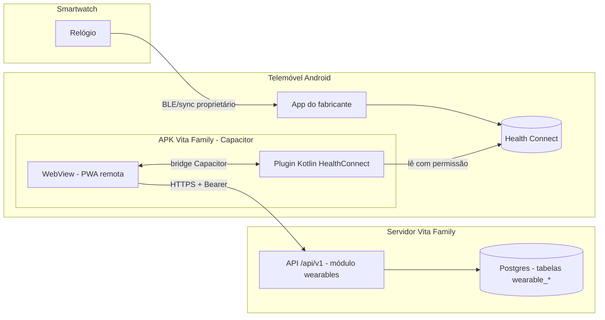
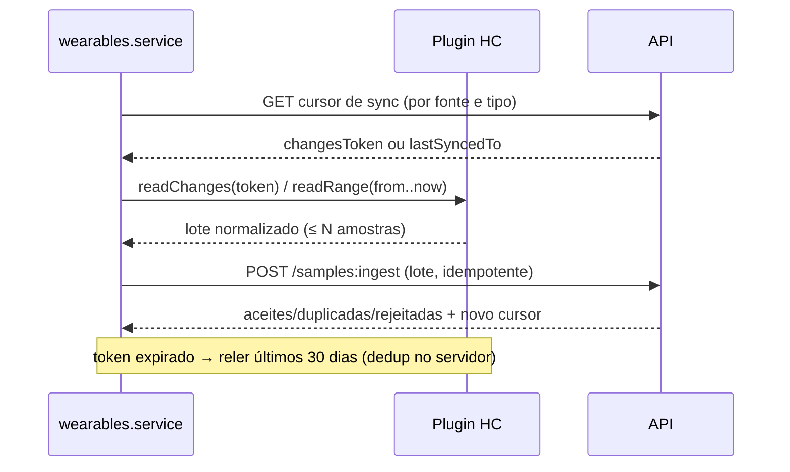

# 03 — Arquitetura proposta

Princípio: **mínimo necessário**. A lista de componentes do pedido (Device Discovery, Compatibility Registry, BLE Adapter, SDK Adapters, Local Persistence…) foi reduzida ao que o MVP precisa. Os restantes ficam como pontos de extensão para a fase 5.

## 1. Visão geral

O relógio nunca fala com a nossa app. A nossa app só lê o Health Connect (fonte do telemóvel) e envia à API.

## 2. Componentes e responsabilidades
| Componente | Onde | Responsabilidade | Decisão |
|---|---|---|---|
| Plugin `VitaHealthConnect` | `apps/web/android` (Kotlin) | `getAvailability`, `getGrantedPermissions`, `requestPermissions`, `readChanges(types, token)`, `readRange(type, from, to)`, `revoke`. Devolve JSON normalizado mínimo + metadados | **Novo**; único código nativo |
| `wearables.service.ts` | `apps/web/src/services` | Orquestra consentimento → permissões → leitura → envio em lotes; mock em dev | Novo, padrão existente |
| Páginas "Relógio" | `apps/web/src/pages/wearables/` | Conectar, painel, métricas, desconectar | Novas, isoladas do hub de saúde |
| Módulo `wearables` | `apps/api/src/modules/wearables` | Fontes (dispositivo/app de origem), consentimento, ingestão idempotente, consultas, revogação e eliminação | Novo, **sem dependência de módulos clínicos** |
| Tabelas `wearable_*` | Postgres | Ver `04-data-model.md` | Novas |
| Registo de compatibilidade | **Não** como componente | As capacidades vêm do que o Health Connect efetivamente devolve/permite (dados > catálogo estático) | Evitado (YAGNI) |
| Camada de normalização | Plugin + domínio `wearables` | Plugin mapeia tipos/unidades do HC → modelo interno; domínio valida | Sem camada separada |
| Persistência local | — | **Nenhuma** no MVP (cursor de sync guardado no servidor) | Respeita política atual |
| BLE / SDKs | — | Fase 5, como novas "fontes" (`source_kind`) no mesmo módulo | Adiado |

## 3. Camadas do módulo (Clean Architecture, conventions §1)
```
modules/wearables/
  index.ts            // única porta de entrada (createWearables)
  domain/             // SampleType, Unit, Origin, regras de validação/limites
  application/        // ConnectSource, IngestSamples, ListSeries, DisconnectSource, DeleteData
                      // ports.ts: WearablesRepo, AccessPolicyPort(local), Audit
  infrastructure/     // repo (Kysely), schema.ts
  interface/          // router, dto (validado pelo OpenAPI)
```
Dependências permitidas (a registar em `modules.md` e `architecture-rules.ts`): `access`, `audit`, `families` (membro/tutela via `access`). **Nenhuma** a `health-records`, `examinations`, `reports`. `reports` e `health-records` não importam `wearables`. `lifecycle` importa `wearables.reads` apenas para exportação.

## 4. Fluxos

### 4.1 Conectar
```mermaid
sequenceDiagram
  actor U as Utilizador
  participant UI as Página Conectar
  participant P as Plugin HC
  participant A as API wearables
  U->>UI: Conectar relógio
  UI->>P: getAvailability()
  alt HC indisponível
    P-->>UI: SDK_UNAVAILABLE / UPDATE_REQUIRED
    UI-->>U: Instruções (instalar/atualizar Health Connect)
  else disponível
    UI-->>U: Ecrã de consentimento (o que se lê, para quê, como revogar)
    U->>UI: Aceito
    UI->>A: POST consentimento (memberId, tipos)
    UI->>P: requestPermissions(tipos)
    P-->>UI: tipos concedidos + fontes (dataOrigin/device)
    UI->>A: POST fonte(s) com capacidades
    UI-->>U: Capacidades detetadas; só mostra tipos concedidos com dados
  end
```

### 4.2 Sincronização (MVP: app aberta)

Cursor guardado no servidor (não no telemóvel) → sem dados locais e recuperável após reinstalação.

### 4.3 Revogação
Utilizador "Desconectar": `DELETE fonte` → marca revogada, pára aceitar ingestão dessa fonte; opção explícita "apagar também os dados" → eliminação real (cascade/DELETE). Plugin `revoke()` pede ao Health Connect a retirada de permissões. Registado em auditoria.

## 5. Frontend (zona "Relógio")
Rotas novas em `paths.ts`: `/relogio` (painel), `/relogio/conectar`, `/relogio/:metrica`, `/relogio/dispositivos`.
- **Painel:** estado, última sincronização, tipos disponíveis, permissões concedidas, problemas de ligação (HC indisponível, permissão negada, token expirado), botão "Sincronizar agora", "Desconectar".
- **Métricas:** cartões e gráfico por tipo, intervalo (dia/semana/mês), com rótulo de origem (medido pelo dispositivo / app de terceiros / estimado / manual).
- Só aparecem tipos suportados e concedidos. Texto sem linguagem de diagnóstico.
- Fora do APK (browser/PWA): a zona mostra "Disponível na app Android" (detecção por `Capacitor.isNativePlatform()` + presença do plugin).

## 6. Alterações por camada
- **Android:** manifest (`READ_*` por tipo, `<queries>` HC, atividade de rationale), dependência `connect-client`, decisão sobre minSdk (24 vs HC ≥ 26/28: manter 24 e ocultar a funcionalidade se indisponível), plugin Kotlin, build release assinado.
- **Web:** páginas, service + mock, tipos, rotas, navegação, componente de gráfico.
- **API:** contrato OpenAPI → migração `0025` → módulo `wearables` → auditoria → exportação `relogio` → testes.
- **Docs:** ADR-025, `modules.md`, `audit.md`, `authorization.md`, `privacy.md` (DPIA), `endpoints.md`, `plan.md` (novo milestone), `docs/README.md` — **só após aprovação**.

## 7. Alternativas rejeitadas
- Registo de compatibilidade estático: duplica o que o Health Connect já informa; apodrece.
- Misturar em `health-records`/`exam_results`: contra decisão do proprietário; origens/qualidade distintas.
- Fila local no telemóvel: choca com a política "sem dados locais"; tratada como questão aberta para fase 5.
