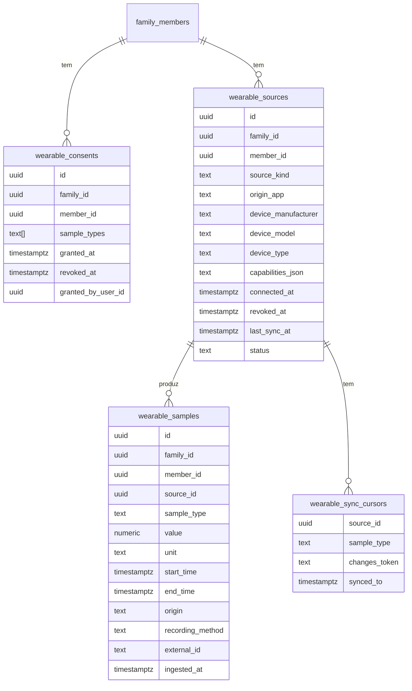

# 04 — Modelo de dados

Dados do relógio vivem em tabelas **próprias**, separadas de `health-records`, `examinations` e `exam_results` (decisão do proprietário). Esquema em proposta; seguir `docs/07-database/schema.md` §4 e a migração `0005_health_records.sql` como modelo. Próxima migração: `0025`.

## 1. Entidades

### wearable_consents
Consentimento explícito por membro e tipos de dados; histórico preservado (revogação = `revoked_at`, nova linha em re-consentimento). `granted_by_user_id` = quem consentiu (o próprio ou o tutor).

### wearable_sources
Um "dispositivo/fonte" ligado. No MVP uma fonte = (membro, `source_kind='HEALTH_CONNECT'`, `origin_app` = pacote que escreve, ex. `com.sec.android.app.shealth`) com `device_manufacturer/model/type` quando o Health Connect os fornecer (podem ser nulos). `capabilities_json` = tipos que efetivamente têm dados/permissão (nunca inventados). `status`: `ACTIVE | REVOKED | ERROR`. `source_kind` prevê `BLE_STANDARD`, `VENDOR_API` para a fase 5 sem nova tabela.

### wearable_samples
Uma linha por amostra/intervalo. Colunas:
| Coluna | Notas |
|---|---|
| `sample_type` | enum: `HEART_RATE`, `STEPS`, `SLEEP_SESSION`, `OXYGEN_SATURATION`, `BLOOD_PRESSURE`, `ACTIVE_CALORIES`, `EXERCISE_SESSION` (extensível; só os suportados/concedidos) |
| `value` + `unit` | valor numérico canónico: bpm, count, minutos, `%`, mmHg (para PA: duas linhas `BLOOD_PRESSURE_SYSTOLIC/DIASTOLIC` ou `value_json`, a decidir), kcal. Unidade guardada **explícita** e validada contra uma tabela fixa por tipo |
| `start_time`, `end_time` | UTC (ADR-010); instante = start=end |
| `origin` | `DEVICE_DIRECT` (medido pelo dispositivo), `THIRD_PARTY_APP`, `DERIVED` (calculado/estimado), `MANUAL` (inserido pelo utilizador) |
| `recording_method` | `ACTIVELY_RECORDED`, `AUTOMATICALLY_RECORDED`, `MANUAL_ENTRY`, `UNKNOWN` (mapeado dos metadados HC) |
| `external_id` | identificador de origem: `clientRecordId` do HC se existir, senão o `id` do registo HC; fallback: hash determinístico de `(origin_app, sample_type, start, end)` |
| `ingested_at` | auditoria; `updated_at` se reescrita |
| `payload_json` (opcional) | só campos auxiliares mínimos (ex. fases de sono), tamanho limitado |

Constraints: FK composta `(family_id, member_id) → family_members(family_id, id) ON DELETE CASCADE` (isolamento ADR-008 e eliminação), FK `source_id`, `CHECK (end_time >= start_time)`, `CHECK` de intervalo plausível por tipo (ex. 20–300 bpm) — valores fora do intervalo **rejeitados com contagem**, nunca "corrigidos".
Índices: `UNIQUE (source_id, sample_type, external_id)`; `(member_id, sample_type, start_time DESC)`.

### wearable_sync_cursors
Por `(source_id, sample_type)`: `changes_token` (opaco do HC) e `synced_to`. Reposição segura se o token expirar (30 dias).

## 2. Origem e qualidade
| Categoria | Origem | Como se identifica |
|---|---|---|
| Medido diretamente pelo dispositivo | `DEVICE_DIRECT` | `recordingMethod` ativo/automático **e** `dataOrigin` = app do fabricante do relógio **[H]**: validar com dispositivos reais |
| De apps de terceiros | `THIRD_PARTY_APP` | `dataOrigin` ≠ fabricante conhecido |
| Calculado/estimado | `DERIVED` | tipos derivados (calorias, sono estimado) ou `recordingMethod` desconhecido com tipo estimativo |
| Manual | `MANUAL` | `recordingMethod = MANUAL_ENTRY` |
Na UI mostra-se sempre a origem. Na dúvida usa-se a classificação menos confiável (`THIRD_PARTY_APP`/`DERIVED`). Sem rótulos de diagnóstico ou classificação "normal/anormal".

## 3. Prevenção de duplicação
1. Chave natural `(source_id, sample_type, external_id)` + `INSERT … ON CONFLICT DO UPDATE` (só atualiza se `lastModifiedTime` mais recente) → ingestão **idempotente**; reenviar lotes é seguro.
2. Dedup após expiração do token: reler 30 dias; mesma chave → upsert.
3. Várias apps a escrever a mesma medição (ex.: relógio→app A→HC e →app B→HC): Health Connect já aplica prioridade de apps para agregados; guardamos por `origin_app`. A UI de métricas agrega **por fonte prioritária escolhida pelo utilizador** (ou a mais recente) para não somar passos duas vezes. **[H]** a validar com dados reais.
4. Lotes com limite de tamanho; resposta devolve `accepted / duplicates / rejected`.

## 4. Volume e retenção
- **[H]** Frequência cardíaca pode gerar muitas amostras. Proposta: enviar HR agregada por minuto/5 min (decidir em fase 3) e guardar bruto só X dias; passos/calorias por intervalo.
- Retenção configurável (**[P]** valor a decidir pelo proprietário); job pg-boss de purga; eliminação imediata sob pedido.

## 5. Minimização
Só tipos consentidos e concedidos; sem localização/rota GPS, sem identificadores do hardware (MAC/serial) — `device_manufacturer/model/type` apenas.

## 6. Integração com o resto do modelo
- **Nenhuma** FK para tabelas clínicas. Só para `family_members` (membro dono) e utilizadores (`granted_by_user_id`).
- `lifecycle`: cascade para eliminação; exportação com secção `relogio` (amostras + fontes + consentimentos).
- `reports`: **sem** integração (relatórios clínicos não leem estes dados). Um futuro resumo do relógio seria um relatório separado, mediante decisão.
- `data_category`: **não alterado** no MVP; acesso por `SELF`/`TUTOR_OF`. Partilha com outros membros fora do MVP (ver 05 e 07).
- Ligar o relógio a um membro: o próprio ou o tutor, dentro das regras existentes do `AccessPolicy`.
